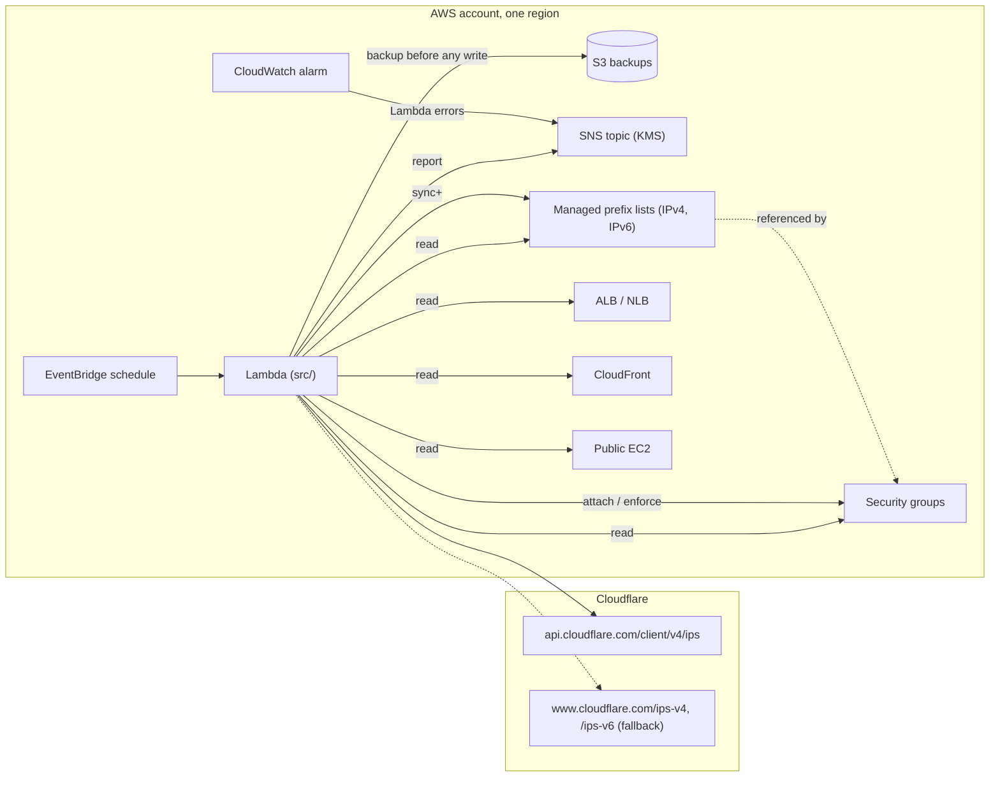

# Architecture

## Components

## Run sequence

`sync_engine.run_sync` performs these steps; each mode skips the ones it is not allowed to do.

1. **Configuration.** Resolve mode, capabilities (`modes.py`), notification policy and the prefix lists involved. A mode that writes prefix lists without a managed list is rejected.
2. **Cloudflare.** If any prefix list is configured, fetch the JSON API (3 attempts), falling back to the plain-text endpoints. Validate every range (see guardrails).
3. **Prefix list state.** Read each managed list and compute the diff (the removal-ratio breaker applies here). Read each compare-only list and diff it too.
4. **Scope.** Find tag-opted-in security groups. The change scope is listed managed groups plus tagged groups. The audit scope adds `SECURITY_GROUP_IDS`.
5. **What you have.** `discover` builds the inventory (`discovery.py`). Other modes run the exposure audit (`audit.py`) when enabled, or always for `attach` / `enforce`.
6. **Plan.** For every audited group, plan the authorize and revoke actions that would make it Cloudflare-only (`remediate.plan_security_groups`).
7. **Backup.** If this run will write anything, back up prefix lists and all in-scope groups. A failed backup stops the run.
8. **Write.** Apply prefix list diffs, then the security group plan for in-scope groups (`remediate.apply_plan`): authorizations first, then revocations per group, subject to the guardrails.
9. **Re-audit.** After live security group changes, audit again (`audit_after`).
10. **Report.** Build the have-vs-needs report (`report.py`) and publish it if the policy says so.

Any exception publishes an error message to SNS (unless `NOTIFY_ON=never`) and fails the invocation, which triggers the CloudWatch alarm.

## Guardrails

| Guardrail | Default | Protects against | When it trips |
| :--- | :--- | :--- | :--- |
| Reject `/0` | always | A corrupted response opening a group to the internet | Run fails before any write |
| Reject private, reserved, loopback, link-local, multicast ranges | always | Internal or bogus ranges entering the Cloudflare list | Run fails before any write |
| Minimum range count | 10 IPv4 / 5 IPv6 | Truncated or empty responses wiping the list | Run fails before any write |
| Maximum removal ratio | 50% per list | Mass removal from a bad response | Run fails before any write, unless forced |
| Backup barrier | always | Changes without a way back | Run fails before any write |
| Revocation needs managed lists | always | Revoking access when Cloudflare access is not guaranteed | Revocations refused |
| Lockout guard | always | A group losing all access because adding Cloudflare rules failed | That group's revocations skipped |
| Revocation cap | 25 per run | Large unreviewed changes | No revocations, error in report, unless forced |
| Private and security-group sources kept | on | Breaking internal callers (health checks, VPC peers) | Not revoked unless opted in |
| Allow-lists | empty | Removing access you intended | Never reported or revoked |
| IAM per mode | always | A misconfigured event or a compromised function exceeding its mode | AWS denies the call |

Prefix list updates are atomic per list: one `ModifyManagedPrefixList` call adds and removes entries and creates one new version, and security groups referencing the list see the new version at once.

Revocations are per group: one `RevokeSecurityGroupIngress` call per group. Security group rule changes apply to new connections; existing tracked connections may continue until they close.

## Security group quota

A rule that references a customer managed prefix list counts as the list's `MaxEntries` toward the rules-per-security-group quota (default 60 inbound), regardless of how many entries the list holds.

| Configuration | Inbound rule units used |
| :--- | :--- |
| IPv4 (30) + IPv6 (20), port 443 | 50 |
| Same, ports 80 and 443 | 100 (needs a quota increase or smaller lists) |
| IPv4 (20) + IPv6 (10), port 443 | 30 |

See [USAGE_GUIDE.md](USAGE_GUIDE.md#rulespersecuritygrouplimitexceeded-when-adding-cloudflare-rules) for options.

## IAM

See [MODES.md](MODES.md#iam-per-mode). Points worth knowing:

- Prefix list writes are limited to the managed lists' ARNs.
- Security group writes are limited to listed group ARNs and to groups carrying the opt-in tag (`aws:ResourceTag`). A companion statement allows the `security-group-rule` and `prefix-list` resource types that EC2 also evaluates for these calls; on their own they allow nothing, because the security group resource must also be allowed.
- Read permissions (`Describe*`, `cloudfront:ListDistributions`) use `*` because these APIs do not support resource-level permissions.
- The SNS topic is encrypted with a customer managed KMS key with rotation enabled; its key policy lets CloudWatch alarms in the same account publish.
- The backup bucket is versioned, encrypted, blocks public access and denies non-TLS requests.

## Threat model

What the tool helps with:

- **Direct-to-origin traffic.** Requests that skip Cloudflare (and its WAF, DDoS protection and rate limiting) by targeting the ALB or instance address.
- **Drift.** Rules added by hand or by other automation that reopen the origin.
- **Stale Cloudflare ranges.** Lists that no longer match what Cloudflare uses.

What it does not solve:

- **Other Cloudflare customers.** They send traffic from the same IP ranges. Use Authenticated Origin Pulls (mTLS) or a secret header so the origin only accepts requests from your zone.
- **Other entry points.** CloudFront, API Gateway, function URLs, public S3, and services outside these security groups. Discovery reports CloudFront and public EC2; the rest is out of scope.
- **Cloudflare account compromise.** If your Cloudflare configuration is changed, traffic still arrives from Cloudflare ranges.
- **Upstream poisoning.** The guardrails reject malformed or suspicious lists, but a valid-looking list containing extra public ranges would be accepted. The removal ratio and minimum count limit the damage; reviewing `UPDATED` reports is the remaining control.

## Module layout

| Module | Responsibility | Writes |
| :--- | :--- | :--- |
| `sync_engine.py` | Orchestration, Cloudflare fetch and validation, prefix list diff/apply, backups, prefix list restore | Prefix lists, S3 |
| `modes.py` | Mode names and capability flags | |
| `discovery.py` | Inventory of load balancers, CloudFront, public EC2 and their groups | |
| `audit.py` | Ingress classification, findings, origin authentication check | |
| `remediate.py` | Tag scope, plan, apply with guardrails, security group restore | Security groups |
| `report.py` | Have-vs-needs report, notification policy, SNS | SNS |
| `lambda_handler.py` | Environment and event parsing | |

All modules import each other both as `src.<module>` (repository, tests, CLI) and as top-level modules (the Lambda zip contains `src/` flattened).
